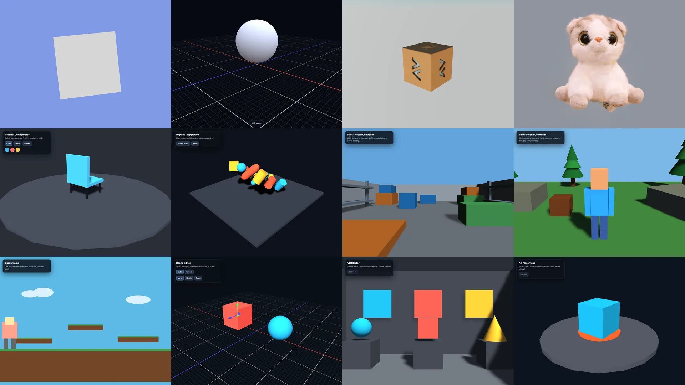

# create-playcanvas

[](https://www.npmjs.com/package/create-playcanvas)
[](https://npmtrends.com/create-playcanvas)
[](LICENSE)
[](https://discord.gg/RSaMRzg)
[](https://www.reddit.com/r/PlayCanvas)
[](https://x.com/intent/follow?screen_name=playcanvas)

| [Engine Manual](https://developer.playcanvas.com/user-manual/engine/) | [React Manual](https://developer.playcanvas.com/user-manual/react/) | [Examples](https://playcanvas.github.io/) | [Forum](https://forum.playcanvas.com/) |

Scaffold a Vite-powered PlayCanvas project with TypeScript. Pick a format and a runnable starter, then build from there.

## Getting Started

```bash
# npm
npm create playcanvas@latest
# pnpm
pnpm create playcanvas@latest
# yarn
yarn create playcanvas
# bun
bun x create-playcanvas@latest
```

Then follow the prompts. Requires Node.js 22.23.2 or later.

## Formats

| Format           | Description                                  |
| ---------------- | -------------------------------------------- |
| `engine`         | The PlayCanvas Engine API directly           |
| `react`          | `@playcanvas/react` components               |
| `web-components` | `@playcanvas/web-components` custom elements |

Every format uses TypeScript and includes Vite, ESLint, Prettier and a production build.

## Starters

Choose from starter kits across basics, viewers, games, tools and XR. Run the creator to browse them; `spinning-cube` is the default.



## Snapchat Web Lenses

The `web-lens` starter is a portrait game ready to publish to Snapchat as a [Web Lens](https://developers.snap.com/web-lenses/home), with the [Web Lens API](https://developers.snap.com/web-lenses/web-lens-api) wired up for leaderboards, Bitmoji and storage:

```bash
npm create playcanvas@latest my-lens -- --starter web-lens
```

Its `npm run package` script builds the game, checks it against the Web Lens upload rules (size limits, relative paths and no network access) and writes the zip to upload through [My Lenses](https://my-lenses.snapchat.com/).

## CLI Options

Pass a project name and options to skip the prompts:

```bash
npm create playcanvas@latest my-game -- -f react -y
```

| Option             | Shorthand | Description                                             |
| ------------------ | --------- | ------------------------------------------------------- |
| `--format <name>`  | `-f`      | Use a format from the list above                        |
| `--starter <name>` | `-s`      | Use a starter from the list above                       |
| `--overwrite`      |           | Remove existing files from a non-empty target directory |
| `--no-skills`      |           | Omit the PlayCanvas agent skills (included by default)  |
| `--yes`            | `-y`      | Skip the prompts and take the defaults                  |
| `--help`           | `-h`      | Show command help                                       |

`--yes` takes `playcanvas-project`, the `engine` format and the `spinning-cube` starter for anything you don't pass. It never deletes files, so a non-empty target directory still needs `--overwrite`. A run without a terminal, such as one started by an AI agent or in CI, takes the same defaults, so it never waits on a prompt. The previous `--template` and `--boilerplate` long flags remain accepted for compatibility.

## Agent skills

Every project includes [`@playcanvas/skills`](https://github.com/playcanvas/skills) so AI coding agents such as Claude Code, Codex and Cursor pick up PlayCanvas-specific workflows automatically, with no install step. They are copied into `.claude/skills/` and `.agents/skills/`. Pass `--no-skills` to leave them out.

## Development

```bash
npm install
npm test
npm run build
node dist/index.mjs
```

Contributions are welcome. Please open an issue before proposing a new format, starter or another substantial change.

### Adding a starter

A project is assembled from the layers under `templates/`, in this order. A file in a later layer replaces the same file in an earlier one, and each layer's `package.json` is merged into those before it.

1. `_common/`: files every project gets
2. `<format>/base/`: the format's tooling and README, a default `index.html` for Engine and React, and React's `src/main.tsx`
3. `_shared/<starter>/`: the starter's format-independent code and assets. Its `README.md` is inserted into the base README above `## Prerequisites`
4. `_features/<feature>/<layer>/`: what each of the starter's `features` needs in that format, as mapped by `FEATURES` in `templates/index.ts`
5. `<format>/<starter>/`: the starter's scene in that format

To add a starter, list it in `STARTERS` in `templates/index.ts`, add `_shared/<starter>/README.md`, and add its scene to every format: `engine/<starter>/src/main.ts`, `react/<starter>/src/App.tsx`, and `web-components/<starter>/index.html` with `src/main.ts`. Import `./starter.css` for the shared page and panel styles, and override a base file only when the starter needs something different. `npm test` checks that the starter exists in every format, and CI scaffolds and builds it in each one.

## License

[MIT](LICENSE)
